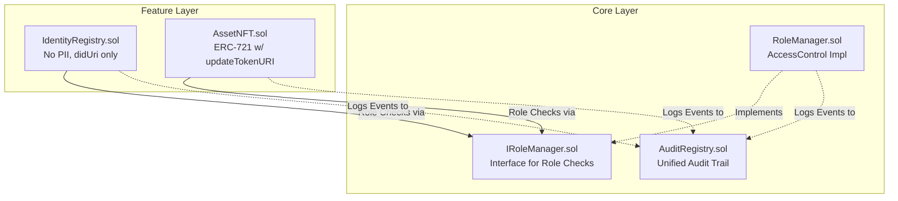

# Hardhat + ethers project

## Project layout

```
contracts/        Solidity source files (*.sol) and unit tests (*.t.sol)
test/             TypeScript integration tests and Solidity unit tests (*.sol)
ignition/         Hardhat Ignition deployment modules
scripts/          Standalone scripts run with `hardhat run`
hardhat.config.ts
```

## Working in this project

When writing or modifying tests, configuring `hardhat.config.ts`, or interacting with the network from TypeScript, invoke the **`hardhat`** skill. It covers Solidity and TypeScript testing, how to choose between them, `forge-std` cheatcodes, the `network.create()` API, `networkHelpers`, and the compile-then-typecheck workflow. The skill itself points to the matching `hardhat-toolbox-*` skill for toolbox-specific guidance (signers, contract interaction, assertions).

## Docs

- Hardhat 3 — https://hardhat.org/llms.txt
- ethers.js — https://docs.ethers.org/v6/

## Architecture Context & Graph

**CRITICAL RULE FOR EFFICIENCY:**
Whenever you are working on this project, you **MUST** look at the Graphify knowledge graph (e.g. `graphify-out/GRAPH_REPORT.md` or via `graphify query`) first and acknowledge the architectural rules. This ensures you maintain context efficiently and respect the Phase 0 strict boundaries.

### Phase 0 Contract Architecture



### Strict Architectural Rules Summary
1. **Data Privacy:** `IdentityProfile` has no PII, only `isActive`, `registeredAt`, `didUri`.
2. **Loose Coupling:** Feature contracts strictly use `IRoleManager`, never `RoleManager` directly.
3. **Admin Multisig Prep:** `DEFAULT_ADMIN_ROLE` assigned to EOA deployer first, easily transferable to Gnosis Safe later.
4. **Metadata Escape Hatch:** `AssetNFT` has an admin-restricted `updateTokenURI` function for future phases.

## graphify

This project has a knowledge graph at graphify-out/ with god nodes, community structure, and cross-file relationships.

When the user types `/graphify`, use the installed graphify skill or instructions before doing anything else.

Rules:
- For codebase questions, first run `graphify query "<question>"` when graphify-out/graph.json exists. Use `graphify path "<A>" "<B>"` for relationships and `graphify explain "<concept>"` for focused concepts. These return a scoped subgraph, usually much smaller than GRAPH_REPORT.md or raw grep output.
- Dirty graphify-out/ files are expected after hooks or incremental updates; dirty graph files are not a reason to skip graphify. Only skip graphify if the task is about stale or incorrect graph output, or the user explicitly says not to use it.
- If graphify-out/wiki/index.md exists, use it for broad navigation instead of raw source browsing.
- Read graphify-out/GRAPH_REPORT.md only for broad architecture review or when query/path/explain do not surface enough context.
- After modifying code, run `graphify update .` to keep the graph current (AST-only, no API cost).
